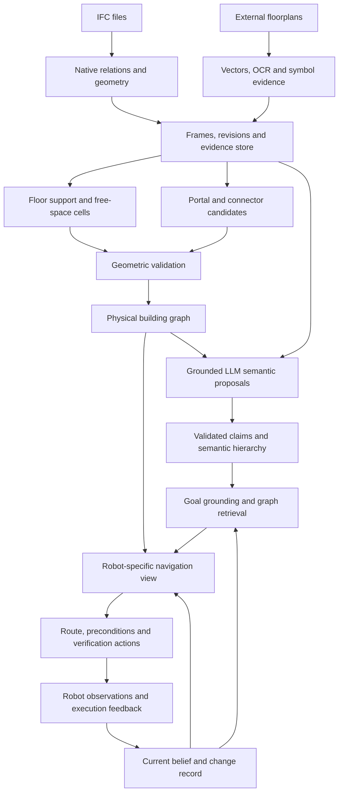

# RoboBIM pipeline redesign — building priors for robot autonomy

For the detailed end-to-end architecture, node/relation schema, worked navigation example and updated annotation status, see [RoboBIM system design](ROBOBIM_SYSTEM_DESIGN.md) (14 September 2026). This document retains the initial redesign rationale and research plan. Phase 0 of the implementation sequence below is complete; see the [M0 implementation record](M0_IMPLEMENTATION_2026_09_14.md) for what was repaired and what was deliberately left open.

The recommended direction is an evidence-grounded building prior with three linked views: physical geometry, semantic hierarchy, and robot-specific navigation. LLMs should interpret and organize evidence, propose missing semantics, resolve language goals, and identify what needs verification. Geometric routines and explicit action preconditions should determine which proposed transitions a robot can use.

This is a proposed design, informed by the [code audit](CODEBASE_AUDIT_2026_09_13.md) and the literature cited below. It is not an experimentally established best method. The working target is indoor navigation and semantic goal finding, with later support for inspection and multiple robot profiles.

**Research objective**

The useful question is: **Does an incomplete building prior help a robot reach the intended goal with less exploration and fewer failed attempts, while exposing uncertainty well enough to recover from a wrong prior?**

That objective preserves the workshop's ambition while changing the evidence required. More filled semantic fields do not establish better autonomy. Better room-edge F1 is useful but is only one contributor to success. A graph should help answer “where should I look?”, “what route is plausible for this robot?”, “what might invalidate it?”, and “what should I observe next?”

I would test this central hypothesis:

> Combining geometry-supported connectivity with grounded semantic hypotheses and explicit verification requirements improves semantic navigation under incomplete or stale building information.

Hierarchy itself is established prior art. Hydra constructs linked geometric, place and room representations; SayPlan uses hierarchical graph search with classical planning and feedback. Their results motivate the architecture, but do not establish that the proposed IFC/floorplan fusion works. [Hydra](https://arxiv.org/abs/2201.13360), [SayPlan](https://proceedings.mlr.press/v229/rana23a.html).

**The key representational decision: distinguish spaces, functions and navigable places**

The current code asks one room node to represent architectural identity, a connected free-space region, a functional label, and a routing state. Those are different things.

Consider a large office: furniture may divide it into two disconnected regions for a wide robot, while a small robot can pass between them. It remains one architectural office. Conversely, a kitchen and dining area may share one continuous floor region but provide different destinations. A stair shaft may cross several floors while offering a usable landing only at particular elevations.

Use a shared entity/evidence store with these views:

| View | Nodes/data | Relations and purpose |
|---|---|---|
| Physical building | Site, building, level, architectural space, element, opening, portal, landing, connector; mesh/section references | Authored containment, bounds, hosts, fills, supports, intersects level, portal-side incidence. Describes the model's physical claims. |
| Semantic hierarchy | Room identity, functional zone, department/unit/wing, asset, affordance hypothesis, restrictions from a source | Part-of, located-in, member-of, serves, affords, requires. Supplies meaning and task abstraction. |
| Navigation | Robot-feasible free-space components, portal approach states, connector actions | Within-region paths, crossings, stairs, ramps and elevator actions with costs, feasibility status and evidence. Supplies executable candidates. |

Keep the spatial ownership hierarchy acyclic. Do not force every relationship into a tree: a door bounds two spaces; a corridor serves several units; an operational zone can overlap several rooms. Membership in a functional zone does not change physical geometry or prove traversability.

Portals need stable identities. A room graph can be a derived, simplified view, but two doors between the same rooms must remain two distinct alternatives. A useful navigation abstraction is a graph of portal-side approach states, with validated within-region paths between them. This retains route geometry and avoids routing via arbitrary room centroids.

**Proposed data flow**



The offline compiler produces a reusable prior. A separate online layer records current observations and execution state. An LLM proposal can request a local geometric recheck; it does not directly turn an unsupported gap into a confirmed crossing.

**1. Ingest evidence before reducing it**

Extract native IFC structure without first committing to the four-layer output schema. Retain GlobalId, STEP ID scoped to its source file, full labels, descriptions, type assignments, relevant property sets and quantities, materials, classifications, groups/zones, systems, and spatial relationships. Specifically preserve void/fill chains, door/opening dimensions and operation types, and space boundaries when available. Inspect stair flights and landings separately from enclosing shafts.

The IFC definition of `IfcRelSpaceBoundary` includes physical and virtual delimiters; a shared boundary is not automatically a passage. Treat schema information according to its relation semantics. [buildingSMART space-boundary definition](https://standards.buildingsmart.org/IFC/DEV/IFC4_3/HTML/lexical/IfcRelSpaceBoundary.html).

Separate declared unit scale, mesh-output units, empirical correction and coordinate transforms. Record why a repair was made. Validate a suspected scale with multiple cues where available—storey separation, door dimensions and geometric extent—and retain ambiguity if cues conflict. A single plausible-height heuristic should not silently determine an entire large hall, mezzanine or multibuilding model.

Use explicit IFC-local, building-local, drawing-pixel and robot-map frames. Preserve the reversible chain of transforms, its source and its quality estimate. IFC map conversion is a distinct engineering-to-map-coordinate operation; it must not be confused with local product placement. [buildingSMART IfcMapConversion](https://ifc43-docs.standards.buildingsmart.org/IFC/RELEASE/IFC4x3/HTML/lexical/IfcMapConversion.htm).

Each input gets a content hash, revision identifier and parser/configuration version. Each output records expected inputs, processing status, errors and omissions. Retain every failed building in the experiment manifest. Repeated-element caching is worth keeping, but its key must account for mapping transforms and scales rather than assuming shared representation identity implies identical placed geometry.

**2. Build a geometry service shared by recovery, rendering and validation**

Retain authoritative meshes or a reproducible geometry cache. Move `_section_segments` into a geometry module and validate it on openings, disjoint components, holes, coplanar surfaces and non-axis-aligned elements. Stitching section lines into valid solid cross-sections needs explicit treatment of nesting and numerical tolerance; the current renderer's line chaining is a useful primitive, not a finished solid-section engine.

Use two related geometric products:

- **Architectural sections** at appropriate heights for walls, doorways, windows and drawing comparison.
- **Robot free space** from floor support and obstacles across the robot's occupied height, including low obstacles, headroom and drops. A single 1.2 m section is insufficient for this.

For a simple upright circular base on a level floor, compute an obstacle projection over its height band and inflate it by the robot radius plus a documented margin. Preserve every connected component. For noncircular bodies or tight turns, use orientation-aware configurations or local swept-volume checking. Stairs, ramps, split levels and landings need 3D support/clearance checks rather than a universal planar reduction.

Physical products participate on every level band they intersect, independently of their one authored storey container. Floor support is explicit: avoid extending a walkable domain across a courtyard, atrium, shaft or absent slab merely because it lies inside a convex envelope. Missing support is an unknown, not automatically solid ground.

Choose tolerances in metres and expose them as configuration. Test sensitivity to raster resolution and small geometric perturbations. Seal modeling cracks only through a recorded repair operation, distinguishable from genuine narrow openings.

**3. Recover atomic regions and retain alternative semantic groupings**

Start with the supported free-space domain. Use valid authored space boundaries and accepted portal cuts as segmentation cues. For missing spaces, use geometric decomposition and bottlenecks—such as a constrained cell decomposition or a distance-transform/watershed proposal—then group the resulting cells into candidate architectural spaces.

Connected components alone cannot find distinct functions within an open plan. Conversely, a false geometric crack should not force the system to merge an entire floor. Keep ambiguous partitions as proposals attached to the same physical cells. A later semantic grouping can combine cells without destroying them; a rejected grouping can be undone without rerunning IFC tessellation.

For stated spaces, compare floor support, geometry and observed/model boundaries before accepting them. Preserve the original authored space even when the robot-facing partition differs. Map inferred instances explicitly across recompilation; a changed raster label is not a reliable persistent room identity.

Do not force every cell into a room. Allow “unassigned region”, supported outdoor circulation, void and unresolved space. Small rooms and thin passages may matter to inspection even when a particular robot cannot enter them.

**4. Recover portals first, then derive room connectivity**

Generate candidates from complementary sources: door/opening host relations, space-boundary relations, actual gaps in sections, and registered floorplan doors or open thresholds. Each candidate stores its source and geometry. A door family name is supporting semantic evidence; its center alone does not determine which rooms it connects.

For each portal, establish two sides and attach them to immediately incident regions. Check that the local crossing passes through the intended opening, reaches both regions, stays on supported floor, and does not cross another barrier. When a door is present but its wall has no modeled void, store the conflict explicitly. The opening can remain a plausible architectural hypothesis and a target for drawing/perception review, without silently rewriting the wall as open.

Separate portal geometry, movable door leaf, and current door state. Closing door apertures can help room segmentation, but a closed door may still be an actionable transition if the robot can open it. An open threshold and a closable door must remain different action types.

Use portal-local cross-sections to estimate usable width/height and approach clearance. IFC `OverallWidth` describes the overall door opening dimension and may be recovered from its opening representation; it should not be equated automatically with effective clear passage under every leaf/frame state. [buildingSMART IfcDoor](https://standards.buildingsmart.org/IFC/DEV/IFC4_3/HTML/lexical/IfcDoor.html).

Represent stairs by landings and flights; ramps by supported slope transitions; elevators by served landings and an action requiring access/control capability. Recover tread/riser dimensions from authored attributes or suitable geometry where possible, recording missing quantities otherwise. A bounding box of a switchback core is neither flight width nor path length. Stacked room names can propose a connector but cannot certify it.

**5. Treat floorplans as a second input with its own uncertainty**

The system should support three input modes through the same evidence schema:

| Input mode | Available evidence | Limit |
|---|---|---|
| IFC only | Native objects, relations, dimensions and geometry | Missing spaces, malformed geometry and stale design remain possible. |
| External floorplan only | Drawing boundaries, room names, dimensions, doors, symbols and legends | Scale, height, floor support and 3D connector geometry may be unknown. Do not issue metric clearance claims without calibration. |
| IFC plus external floorplan | Complementary geometric and semantic claims | Registration, model revision and conflicting evidence must be resolved explicitly. |

For vector PDF/SVG drawings, extract text, paths, layers and symbols before raster inference. For scanned plans, use OCR and a floorplan-specific perception model to propose walls, doors and room regions. Use VLMs for legend interpretation, symbol ambiguity, contextual association and difficult crops. Measure each role independently. CubiCasa5K establishes that floorplan-specific image analysis is a distinct supervised problem; it does not establish robustness on this corpus's scanned or commercial drawings. [CubiCasa5K](https://arxiv.org/abs/1904.01920).

Register each drawing to a level using dimensions, wall intersections, columns and other stable landmarks. Begin with the simplest justified transform—usually a planar similarity transform for an undistorted drawing—and allow more flexible transforms only when the source warrants them. Record control points, residuals, scale and registration uncertainty. A failed alignment must not attach text or doors to nearby IFC rooms by guesswork.

Associate labels with regions using location, leaders, text orientation and context. Require each extracted claim to point to the source page/crop or vector entity. A VLM may propose a “kitchen” interpretation; it should not supply unsupported metre coordinates or door clearances.

IFC-generated drawings are useful views of existing evidence, including debugging views. They are not independent corroboration of the IFC. Distinguish these from drawings supplied by an architect, owner or scanned record, and record whether both sources represent the same revision.

**6. Give the LLM specific semantic tasks**

The current fixed room-label classifier is a reasonable baseline, but it underuses the available language signal. Expand its role through a small number of bounded tasks:

| Task | Input and output | Validation |
|---|---|---|
| Vocabulary normalization | IFC names/properties, drawing labels and legends → canonical concepts plus preserved original wording | Taxonomy validity, source spans, multilingual aliases, explicit unknown |
| Room/function hypotheses | Contents, area/shape summaries, portal graph, neighboring evidence and aligned crop → ranked functions and evidence references | No invented elements; no transformation of hypotheses into observed facts |
| Hierarchical grouping | Supported cells/rooms and source labels → apartment/unit/department/wing or functional-zone proposals | Valid member IDs, spatial plausibility, acyclic part-of; overlapping membership allowed where meaningful |
| Affordance interpretation | Known asset/space properties → possible tasks and required capabilities | Separate “supports this task” from “robot can execute it now” |
| Conflict triage | Disagreeing source claims → targeted query, crop inspection or geometric recheck | Tool output, rather than model confidence, supplies new evidence |
| Goal grounding | Language goal and retrieved graph → ranked target IDs, constraints and ambiguity | Existing IDs, exact identifiers first, storey/unit constraints and reachability |

Run deterministic extraction and high-precision normalization first. Retrieve only the relevant evidence for each unresolved task. Batch related rooms when relational context is useful, but cap iteration so semantic proposals cannot reinforce themselves indefinitely.

Store original authored labels separately from interpreted function, confidence and model provenance. “Kitchen” may support a hypothesis that wet areas are more likely; it does not prove a wet floor, a hazard event, access permission, or a numerical traversability score. A kitchen may afford fetching water, but only a grounded sink/dispenser and reachable interaction pose should support that specific action.

Use structured output with stable IDs, allowed relations, evidence references, alternatives, unknown/abstain, and a short evidence summary. Validate the output deterministically. Record model revision, prompt/configuration hash, input-evidence hash, raw response, parsing status, runtime, token usage and any fallback. A rule fallback remains a rule fallback in the result record.

Do not interpret model-reported confidence as calibrated probability. Initially use categorical support levels. If probability outputs improve decisions, calibrate them on a development split and report reliability/Brier score and risk-versus-coverage on untouched buildings. Model confidence must not override contradictory physical evidence.

**7. Make uncertainty and provenance part of the API**

Represent a claim separately from the entity it describes. The minimum useful record is:

```json
{
  "id": "claim-104",
  "subject": "space-27",
  "predicate": "has_function",
  "value": "kitchen",
  "status": "hypothesis",
  "evidence_ids": ["drawing-text-18", "ifc-fitting-42"],
  "derived_from": [],
  "method": "semantic_interpretation",
  "method_version": "recorded-at-run-time",
  "valid_time": null,
  "probability": null,
  "alternatives": ["utility"]
}
```

Keep author-stated, geometrically derived, model-inferred, human-reviewed and robot-observed origins distinct. Origin is not certainty. Include rejected and superseded claims in history; the current view selects applicable claims without deleting the evidence that produced them.

Evidence dependency matters: an IFC room name, a feature derived from that name, and a rendered label from the same IFC are not three independent votes. Begin with rule-based evidence precedence and conflict handling rather than a large probabilistic model that assumes independence incorrectly. A richer factor model becomes justified only if calibrated probabilities materially improve decisions.

Use three-valued feasibility: **feasible under stated assumptions**, **infeasible**, and **unknown**. An exploration policy may deliberately choose an unknown route to verify it. An execution policy must be able to see that choice and its unresolved preconditions. Unknown should neither silently disconnect the prior nor masquerade as verified passage.

**8. Couple hierarchy to a usable robot interface**

Expose a small set of bounded operations:

```text
summarize_building(scope)
expand_region(region_id, detail_budget)
resolve_goal(text, start_pose, robot_profile)
inspect_evidence(entity_or_claim_id)
plan_route(start_pose, target_id, robot_profile, uncertainty_policy)
report_observation(entity_id, observation, timestamp, frame)
```

Every result identifies the graph version, units/frame, source claims and unknowns. A route returns target/portal IDs, physical path length where known, separate task cost, required actions, feasibility status and verification needs. Avoid returning a single number called `length_m` that includes penalties.

Robot profiles include footprint, height, turning constraints, step/ramp capabilities, necessary clearance margins, door-manipulation ability and elevator access. “Wheeled” versus “legged” is a coarse preset, not a capability proof. Fine-grained checks can be lazy: validate the local geometry along promising routes and cache by geometry/profile revision.

Ground goals with exact names/numbers and explicit storey/unit constraints before broad semantic matching. For “the kitchen next to the meeting room on level 2”, retrieve candidate kitchens on that level, evaluate the requested spatial relation, then compare usable routes. If multiple targets remain plausible, return the ambiguity or an observation that resolves it instead of choosing the first node.

Hierarchical retrieval limits the model's context to task-relevant regions; classical search handles route expansion. This adapts SayPlan's division of labor. Task-relevant graph views can also follow Clio's principle of retaining useful granularity, while keeping an underlying evidence store so a new task can recover previously omitted detail. [SayPlan](https://proceedings.mlr.press/v229/rana23a.html), [Clio](https://arxiv.org/abs/2404.13696).

**9. Add online observations without erasing the design prior**

Localize the robot against the prior using a verified map transform and data association. Maintain a current-state overlay for blocked portals, moved objects, changed room use and connector availability. A temporary blocked doorway should not remove the architectural opening; an observed demolition should create a structural change claim with evidence and revision scope.

When a route fails, inspect the failure's cause: wrong association, wrong geometry, temporary blockage, insufficient robot capability or wrong semantic target. Update the relevant claim, invalidate dependent route checks and replan. This turns the prior into a source of informed alternatives and targeted observations.

A first implementation can use deterministic state transitions and explicit unknowns. Full Bayesian mapping, online language agents and continual training are optional later extensions, not prerequisites for a useful offline prior.

**Evaluation that can decide whether this works**

Establish separate conditional and end-to-end tracks. Conditional topology uses a common, trusted region/portal set and isolates edge inference. End-to-end evaluation includes missed, spurious, merged and split rooms and the consequences for navigation.

| Question | Measurement |
|---|---|
| Is geometry extracted correctly? | Section/opening validity, room IoU with explicit one-to-one assignment, split/merge counts, support/clearance errors, rotation/unit/translation invariance |
| Is topology correct? | Portal detection and side incidence; typed edge precision/recall; false connections through walls/voids; missing connectors; completeness and unknown rate |
| Are semantics useful? | Macro F1, per-class recall, hierarchical/multilabel accuracy where relevant, exact goal grounding, evidence-support rate, selective risk and coverage |
| Is uncertainty useful? | Incorrect feasible-route rate, abstention rate, verification effort, calibrated probability quality if probabilities are used |
| Does the robot benefit? | Correct-goal arrival, task success, actual traveled distance/time, exploration required, failed crossing attempts, replanning and recovery cost |
| Does hierarchy help? | Retrieval recall, goal/plan accuracy, token use and latency as building/task size increases |

For semantics, report both isolated-label masking and blocks of missing labels: contiguous rooms, entire floors, and actually recovered spaces. Mask target information before graph-derived features are built. Keep full per-target predictions and evidence so leakage and crop mismatches can be audited.

Split by building and, where identifiable, by original design/export family or authoring project. The 25-model corpus is a subset of the larger collection, not an independent second test set. Deduplicate source/model variants before splitting; hold all perturbations of one building in the same split. Tune rules, prompts, tolerances and thresholds only on training/development data. Aggregate uncertainty at the building level, not as though hundreds of rooms were independent samples.

Strengthen the synthetic generator with rotated and nonrectangular layouts, courtyard/atrium holes, multi-height walls and lintels, realistic doors and opening voids, double doors, narrow vestibules, stairs with slab apertures and landings, ramps/elevators, absent support, units/placement variants, overlapping or missing spaces and revision conflicts. Keep the current simple family as a fast regression set. Independently verify the relevant geometry, including vertical passages; distinguish intentional architectural graph truth from embodied traversability truth.

Build a manually checked real test subset from source IFC and independent plans where available. Existing annotations are a pilot to repair and extend. Include rejected links, uncertain items, all missing rooms/portals, and explicit review coverage. Have two annotators independently review a subset, adjudicate disagreements, and report their agreement by relation type. Agreement is a characterization of label uncertainty, not a mathematical ceiling on model accuracy. Hide method identity/predicted semantic labels for the independent test portion and show raw source views to reduce anchoring. Keep bulk judgments separately identifiable.

Use two real-data sampling views: a representative deployment slice, and a deliberately challenging diagnostic slice. Do not change their negative prevalence after seeing which method wins. Keep algorithmically derived references out of the final test labels unless individually adjudicated.

Compare the following on the same splits and input availability:

1. No architectural prior, using the same robot navigation/perception stack.
2. Geometry-only prior with validated portal connections.
3. Geometry plus native IFC/drawing semantics and deterministic rules.
4. The same evidence plus grounded text LLM interpretation.
5. The same system with independent floorplan input and optional vision.
6. The full prior with explicit unknowns and online verification.

Then ablate hierarchy, evidence validation and semantic inference separately. Compare text-only and vision with identical target IDs, accessible textual evidence and controlled inference budgets. A strong supervised classifier or graph model is also a useful label baseline when sufficient training data exists; an LLM must earn its additional cost.

Ifc2Graph is a useful geometric-adjacency baseline but not a like-for-like traversability system. Preserve its intended relation in reporting, and evaluate both adjacency and downstream adaptation rather than relabeling its outputs as doors. Recent BIM work already includes metric, semantic and topological maps, so “three layers from IFC” is too broad a novelty claim. The stronger prospective contribution is validated recovery under incomplete evidence and measured value for embodied decisions. [Ayembilla et al., ISARC 2026](https://www.iaarc.org/publications/2026_proceedings_of_the_43rd_isarc_singapore/an_automated_pipeline_for_generating_a_multi_layered_spatial_map_for_indoor_robot_navigation_from_bim_data.html).

**Implementation sequence and acceptance criteria**

| Phase | Concrete work | Completion criterion |
|---|---|---|
| 0 — Trustworthy baseline | Repair annotation verdicts/unknowns, real GT adapter, portal edge IDs/serialization, VLM target IDs, source manifests and fail-visible runner. Freeze existing outputs. | Every audit reproduction is an executable regression case; human annotations round-trip into the evaluator; no missing run silently changes denominators. |
| 1 — Physical prior | Preserve IFC relations/properties, add frame/unit records, shared geometry cache, sections and support, cell/portal incidence, explicit connector unknowns. | Rotation/unit tests preserve topology and dimensions; lintels/holes/narrow vestibules pass; multiple doors survive; a known false opening never becomes feasible without evidence. |
| 2 — Robot route contract | Add approach states, within-region paths, profile-aware clearance and connector actions; separate cost from distance. | Every feasible route has a local geometric witness and declared preconditions; unknown requirements are returned explicitly. |
| 3 — Semantic prior | Structured claim model, normalization, richer evidence, grounded LLM proposals, goal resolution and semantic hierarchy. | No fabricated references; audited fallback accounting; improvement over the deterministic evidence baseline on held-out buildings and target goals. |
| 4 — Independent drawings | Ingest a small set of paired plans, extract text/vector/symbol evidence, register, fuse and report conflicts. | Measured registration and claim-association accuracy; a controlled experiment establishes whether drawings add value. |
| 5 — Embodied evaluation | Simulation/robot adapter, online observation overlay, blocked/changed-map tasks. | Demonstrated benefit against the same stack without the prior, with failures and verification cost included. |

The first vertical slice should use one simple supported building, one incomplete-space building and one multistorey case, with manually verified portals. Deliver a saved/reloaded graph and a robot-profile route with evidence before scaling the language stages. Proceed to a paired-plan example once the geometry and annotation contracts work.

A modest package layout is sufficient:

```text
bimsg/
  model/          entities, claims, evidence, frames, versions
  ingest/         ifc, vector plans, raster plans, source manifests
  geometry/       mesh cache, sections, support, free space, registration
  topology/       cells, portals, connector candidates, validation
  semantics/      normalization, features, model backend, claim validation
  navigation/     robot profiles, local paths, actions, planning
  queries/        retrieval, goal grounding, evidence inspection
  updates/        observations, state transitions, dependency invalidation
  export/         versioned graph and robot adapters
evaluation/       matching, split manifests, metrics, task protocols
annotator/        shared schemas, independent review, evidence visualization
```

Keep a single source of truth for the annotator and shared graph contracts. NetworkX and typed Python records are sufficient initially; a graph database is not required to establish the method. Store geometry externally with stable references, but make a saved artifact sufficient for inspection and route validation without silently recompiling a different graph.

The decision to increase LLM complexity should come after the deterministic evidence baseline and real evaluation are trustworthy. The most promising immediate investment is the geometry/portal contract plus a repaired human benchmark; the most valuable LLM contribution is grounded semantics and goal reasoning over that foundation.
