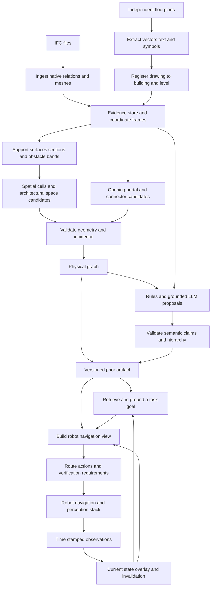
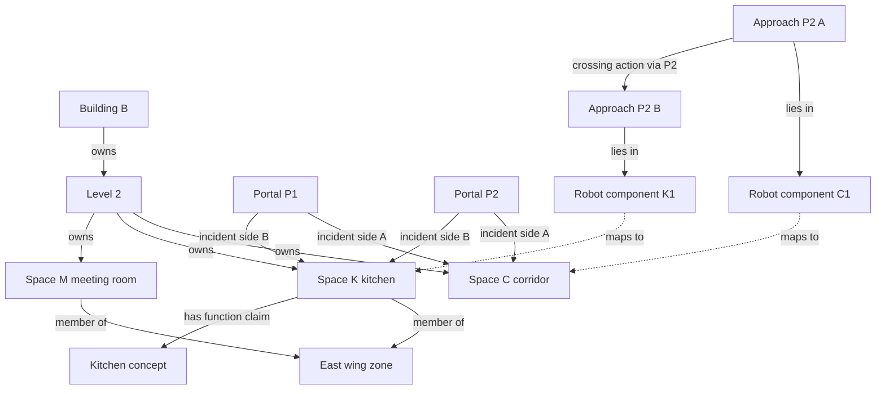
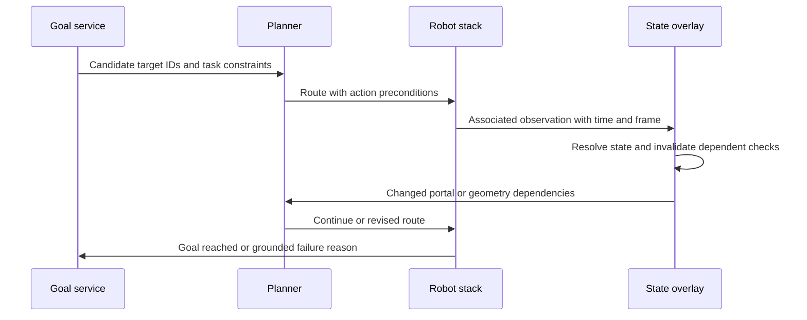
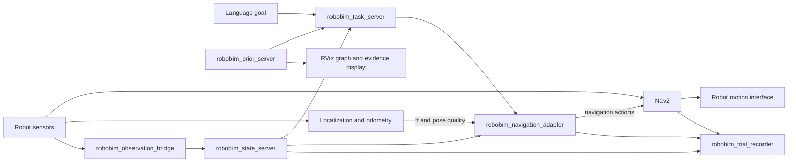

# RoboBIM system design: from IFC and floorplans to a robot building prior

**Status:** proposed architecture, 14 September 2026. This specifies the intended system; it does not describe features already implemented or a method already proven superior experimentally.

**Initial application:** indoor navigation and semantic goal finding. The architecture accommodates inspection, manipulation and different robot capabilities, but the first implementation should establish reliable goal arrival.

**Related documents:** [code audit](CODEBASE_AUDIT_2026_09_13.md), [initial redesign proposal](PIPELINE_REDESIGN_2026_09_13.md), [annotation import](ANNOTATION_IMPORT_2026_09_14.md), [M0 implementation record](M0_IMPLEMENTATION_2026_09_14.md), and the [ROBOBIM workshop manuscript](../icra_paper/RoboBIM_ICRA26_WS/conference_revised.tex).

## Reading guide

1. [Purpose and design principles](#1-purpose-and-design-principles)
2. [System overview](#2-system-overview)
3. [What the hybrid graph represents](#3-what-the-hybrid-graph-represents)
4. [Node types and attributes](#4-node-types-and-attributes)
5. [Relations and structural rules](#5-relations-and-structural-rules)
6. [Evidence, uncertainty and identity](#6-evidence-uncertainty-and-identity)
7. [Offline pipeline in detail](#7-offline-pipeline-in-detail)
8. [The LLM interface](#8-the-llm-interface)
9. [Robot navigation and online updates](#9-robot-navigation-and-online-updates)
10. [Worked example](#10-worked-example)
11. [Serialization and software structure](#11-serialization-and-software-structure)
12. [Manual annotation and evaluation](#12-manual-annotation-and-evaluation)
13. [Migration and acceptance criteria](#13-migration-and-acceptance-criteria)
14. [Decisions, tradeoffs and open questions](#14-decisions-tradeoffs-and-open-questions)
15. [ROS 2 integration architecture](#15-ros-2-integration-architecture)
16. [End-to-end testing on a real robot](#16-end-to-end-testing-on-a-real-robot)

## 1. Purpose and design principles

The output is a **building prior**: a structured account of what the robot can expect, why it should expect it, and what still needs checking. It supports questions such as:

- Where is the kitchen in the east wing on level 2?
- Which route could this robot take to it?
- Which parts of that route depend on an open door, an accessible elevator or uncertain geometry?
- What should the robot inspect if the route fails?
- How should a new observation change subsequent plans?

The scientific hypothesis is that geometry-supported topology, grounded semantics and explicit uncertainty reduce exploration and failed actions when building information is incomplete or outdated. Success must be measured through robot tasks as well as extraction metrics.

Five principles determine the architecture:

| Principle | Consequence | Reason |
|---|---|---|
| Preserve source evidence | Keep IFC attributes, geometry, drawing references and observations alongside interpretations. | Later corrections and new tasks need information that a single room label cannot retain. |
| Separate identity, function and reachability | Architectural spaces, semantic groups and robot free-space components have different records. | Furniture can split a robot's free space without creating a new architectural room. |
| Model each transition explicitly | A portal has identity, geometry, sides and evidence. | Two doors between the same rooms can have different widths and states. |
| Make uncertainty actionable | Queries return unknown requirements and possible verification actions. | A plausible opening can help exploration without being treated as confirmed passage. |
| Evaluate the whole task | Preserve failures and incomplete coverage in experiment manifests. | High edge accuracy alone does not demonstrate arrival at the correct destination. |

Layered spatial representations have a strong precedent in [Hydra](https://arxiv.org/abs/2201.13360), which links geometric information, places and rooms. [SayPlan](https://proceedings.mlr.press/v229/rana23a.html) motivates hierarchical semantic retrieval combined with classical planning and feedback. The IFC/floorplan reconstruction, evidence contracts and experiments below are proposed RoboBIM design choices; those papers do not validate them automatically.

## 2. System overview

The system has an offline compiler, a query/planning service, and an online observation layer. They share versioned entity and evidence records.



A fourth path, **annotation and evaluation**, reads source evidence and frozen outputs to produce reviewed references and metrics. Held-out test annotations must not flow into the compiler or runtime prompts. Development annotations can guide repairs, with that use recorded.

### Input modes

| Mode | What can be produced | What may remain unknown |
|---|---|---|
| IFC only | Physical entities, modeled geometry, semantic evidence, candidate routes | Missing boundaries, operational state, stale construction details |
| Independent floorplan only | Drawing-space regions, labels, doorway hypotheses and relative topology | Metric scale, headroom, floor support, connector geometry |
| IFC plus independent plans | Aligned evidence and cross-source conflict detection | Which revision matches the building; ambiguous registration |
| Prior plus robot observations | Current-state route decisions and change hypotheses | Unobserved areas and uncertain data association |

An IFC-rendered plan remains evidence derived from that IFC. Its visual presentation can help interpretation, but it is not independent confirmation of the underlying geometry.

### Stage contracts

Every stage receives explicit input artifact IDs and configuration, and returns outputs, diagnostics and status. The status is `success`, `partial` or `failed`, with reasons. A failed building remains in the run manifest. Re-running a stage must not silently overwrite a different experiment.

The minimum output is an inspectable artifact containing graph records, referenced geometry, evidence references, coordinate frames and processing omissions. The robot service must be able to load it without rerunning extraction and accidentally producing different room identities.

## 3. What the hybrid graph represents

“Hybrid” means the system joins metric geometry, typed relationships, semantic abstractions and robot action feasibility. Conceptually there is one versioned information model with three derived graph views. It does not require three independent databases.

### Physical view

This describes entities and spatial relationships in the modeled building: sites, buildings, levels, spaces, walls, slabs, doors, openings, portals, stairs and landings. It preserves both authored information and derived geometric claims.

The physical view can say that an opening exists in a wall and lies between two regions. Whether a robot can cross it depends on its dimensions, approach geometry and current state.

### Semantic view

This describes meaning: room functions, named destinations, apartments, departments, wings, functional zones, assets and possible tasks. It retains source labels and interpreted concepts separately.

A department can occupy rooms on several levels. A circulation zone can serve several departments. These memberships do not alter walls or force the physical graph into a tree.

### Navigation view

This describes where a particular robot can move and which actions connect those places. Its nodes include free-space components, portal approach configurations and interaction goals. Its edges include within-region paths, portal crossings and connector actions.

This view is derived for a robot profile and state revision. Changing robot width or observing a blocked passage can change this graph while the architectural room identities remain stable.



This is a conceptual projection. Detailed portal sides attach to geometric cells; the architectural-space links shown here are derived through cell-to-space associations. Claim and evidence records support the relationships but are omitted from this diagram for readability.

### Four spatial concepts that must remain distinct

| Concept | Example | Stability |
|---|---|---|
| Architectural space | A room authored as Kitchen 2 | Persists across robot profiles and many layout changes |
| Spatial cell | A geometric subdivision used to preserve boundaries and candidate partitions | Depends on source geometry and decomposition version |
| Robot free-space component | A connected set of collision-free, supported configurations | Depends on geometry, profile and relevant state assumptions |
| Functional zone | Kitchen work area within an open-plan kitchen/dining space | Depends on semantic evidence; can overlap other zones |

Cells are an implementation device for preserving geometry while evaluating groupings. They are not automatically semantic rooms. Robot components may span several cells, or one cell may yield several components after obstacle inflation.

## 4. Node types and attributes

All entity records have `id`, `type`, `revision`, optional `source_refs`, and references to relevant claims. Geometry-bearing records also have `geometry_refs` and `frame_id`. A missing measurement is `null` or absent with an explicit reason; it never defaults to zero or a permissive clearance.

### Physical entities

| Type | Key attributes | Explanation |
|---|---|---|
| `Site` | Original identity, coordinate references | Optional context for one or more buildings |
| `Building` | Source identity, name, building frame | Keeps multiple buildings separate within one project |
| `Level` | Name, authored elevation, derived support bands | Authored storey membership and geometric height are separate |
| `Space` | Original name/number, authored or inferred origin, boundary references | Architectural identity; interpreted function is a claim |
| `SpatialCell` | Polygon/volume reference, support reference, decomposition revision | Atomic region for boundary recovery and grouping |
| `Element` | IFC class, type, properties, materials, geometry references | Includes walls, slabs, furniture and relevant building assets |
| `Opening` | Host element, aperture geometry, source relations | Geometric opening in an element; may be a window or other nontraversable void |
| `Portal` | Portal kind, side IDs, aperture reference, candidate status | A proposed or validated transition through a doorway or open threshold |
| `PortalSide` | Portal ID, local side, incident cell claim, approach zone reference | Prevents a nearest-room heuristic from hiding ambiguous incidence |
| `Connector` | Stair/ramp/elevator kind, landing IDs, capability requirements | A potentially multi-level transition system |
| `Landing` | Support geometry, level association, connector association | A concrete supported entry/exit location |

A door leaf is an `Element`; its opening and traversable portal are separate entities. A portal may exist without a door leaf, as at an archway. An opening may exist without any navigable portal, as at a high window. Repeated door products and geometric openings need explicit association to prevent duplicates.

### Semantic entities

| Type | Key attributes | Explanation |
|---|---|---|
| `Concept` | Canonical term, aliases, taxonomy revision | Function or category such as kitchen, office or circulation |
| `SemanticGroup` | Group kind, original label, membership claims | Apartment, wing, department, unit or functional zone |
| `Affordance` | Task kind, supporting entity, required capabilities and state | A possible interaction, such as obtaining water at an identified dispenser |

A physical sink can use the existing `Element` identity with semantic claims. It does not need a duplicate object node solely because the semantic view uses it. “Kitchen” alone can support a search preference for a dispenser; it does not prove that one exists.

### Navigation entities

| Type | Key attributes | Explanation |
|---|---|---|
| `NavComponent` | Profile hash, geometry/state dependencies, free-space reference | Connected admissible configurations under recorded assumptions |
| `ApproachState` | Pose or admissible pose set, component ID, portal/landing reference | Valid place to approach a crossing or connector |
| `GoalRegion` | Target entity, admissible poses, task condition | Goal arrival can require entering a region or reaching an interaction pose |

Edges represent actions; they are not additional permanent physical entities. Every action refers back to the physical transition and validation evidence that justifies it.

## 5. Relations and structural rules

The graph is a directed typed multigraph. Every stored relation has its own `edge_id`; the relation name alone is not an edge key. Multiple portal alternatives and multiple evidence claims therefore survive insertion and serialization.

### Relation vocabulary

| Relation | Endpoints | Semantics |
|---|---|---|
| `owns` | Site → Building → Level → Space, where applicable | Canonical spatial ownership; acyclic and at most one canonical owner per entity |
| `authored_contains` | Native IFC entities | Original source relationship, even when unsuitable as canonical ownership |
| `intersects_level` | Element/Space/Cell → Level | Geometric extent across a level band, independent of ownership |
| `bounds` | Element/boundary representation → Space/Cell | A physical or virtual boundary; does not imply passage |
| `hosts` | Element → Opening | Opening belongs to a host element |
| `fills` | Element → Opening | Door/window element is associated with an opening |
| `has_side` | Portal → PortalSide | An ordinary portal has two oriented sides once resolved |
| `incident_to` | PortalSide → SpatialCell | Immediate local incidence; unresolved alternatives remain competing claims |
| `associated_with` | SpatialCell → Space | Cell supports an architectural space hypothesis, with overlap evidence |
| `has_landing` | Connector → Landing | Explicit served locations; no automatic all-pairs route generation |
| `member_of` | Space/Element/SemanticGroup → SemanticGroup | Functional or organizational membership |
| `has_function` | Space/SemanticGroup → Concept | Semantic claim with evidence and possible alternatives |
| `affords` | Space/Element → Affordance | Supported potential task |
| `within_component` | ApproachState/GoalRegion → NavComponent | Membership under a specific navigation-view revision |
| `within_region_path` | Navigation state → Navigation state | Locally validated path within admissible free space |
| `cross_portal` | ApproachState → ApproachState | Crossing action through a specific portal |
| `use_connector` | Navigation state → Navigation state | Stair, ramp or elevator action with capability/state requirements |

Native IFC space boundaries may be physical or virtual. Their presence supports boundary interpretation, not automatic traversability. This follows the [buildingSMART definition of IfcRelSpaceBoundary](https://standards.buildingsmart.org/IFC/DEV/IFC4_3/HTML/lexical/IfcRelSpaceBoundary.html).

### Enforced invariants

1. Every relation endpoint exists, and endpoint types match the relation schema.
2. Canonical ownership and hierarchical group-parent relations are acyclic. Overlapping membership is allowed; circular hierarchy is not.
3. Every geometry reference declares frame and units. Local and global coordinates are never silently mixed.
4. A resolved ordinary portal has two sides and validated immediate incidence. A candidate may have incomplete sides but cannot issue a feasible crossing.
5. Room adjacency means shared/proximate boundary under a declared geometric rule. Room connectivity means a supported transition exists. Neither is inferred from semantic similarity.
6. An exterior-facing portal can attach to a supported outdoor cell. Exterior space is not automatically discarded, and an unmodeled outside region does not become supported terrain.
7. Every navigation edge has direction, dependencies, action type, feasibility and validation status. Reverse movement is checked or explicitly justified; it is not assumed for every action.
8. Save/load preserves entity IDs, edge IDs, claims, geometry references and unknowns.
9. No edge involving an unconfirmed endpoint becomes confirmed merely because the other endpoint is valid.
10. Aggregate views retain references to the detailed entities they summarize.

For a simple room graph, derive a connection between spaces when at least one portal or connector alternative links their associated regions. Return the alternative IDs. Never collapse their widths or states into an arbitrary last value.

## 6. Evidence, uncertainty and identity

### Evidence and claims

An **evidence record** points to something inspectable: an IFC attribute, mesh patch, drawing text span, reviewed annotation or sensor observation. A **claim** interprets evidence: this cell belongs to this room, this portal joins these cells, or this space probably functions as a kitchen.

Separate three questions:

- **Origin:** authored, geometric computation, rule, LLM, human review or robot observation.
- **Lifecycle:** proposed, accepted, rejected or superseded.
- **Support:** directly stated, geometrically checked, corroborated, conflicting or insufficient, with a specified scope.

An accepted claim has passed its validation policy. That does not make an LLM room-function hypothesis a physical observation. Similarly, a source-authored door state may be stale.

The following are illustrative record fragments, not a complete artifact or an implemented JSON Schema. IDs named in references would be defined elsewhere in the artifact.

```json
{
  "id": "claim:kitchen-function:01",
  "subject_id": "space:K2",
  "predicate": "has_function",
  "object_id": "concept:kitchen",
  "origin": "llm",
  "lifecycle": "accepted",
  "support": "corroborated",
  "scope": "function_at_source_revision",
  "evidence_ids": ["evidence:ifc-label:K2", "evidence:plan-text:83"],
  "derived_from_claim_ids": [],
  "alternatives": ["concept:utility_room"],
  "calibrated_probability": null,
  "method_run_id": "semantic-run:12"
}
```

Accepting this record means the output used valid entities, relevant evidence and an allowed predicate. Its function remains an inference. Probability remains unset until a calibration procedure supports it.

A quantity is also a claim, with measurement method and uncertainty:

```json
{
  "id": "claim:portal-P2-clear-width",
  "subject_id": "portal:P2",
  "predicate": "has_clear_width",
  "value": {
    "estimate": 0.94,
    "interval": [0.92, 0.96],
    "unit": "m",
    "interval_kind": "engineering_tolerance"
  },
  "origin": "geometry",
  "lifecycle": "accepted",
  "support": "geometrically_checked",
  "scope": "source_revision_with_leaf_fully_open",
  "evidence_ids": ["evidence:aperture-section:P2"],
  "derived_from_claim_ids": [],
  "method_run_id": "geometry-run:07"
}
```

The interval above is invented for the worked example. It is not a measured corpus value or a calibrated confidence interval. Authored opening width, leaf dimensions and effective clear passage require separate quantities.

### Conflict handling

Do not average incompatible claims without understanding their scopes. A drawing from one revision and an IFC from another can disagree legitimately. A current observation of a closed door can coexist with the architectural claim that the doorway exists.

Initially use explicit, predicate-specific resolution rules. For temporary state, prefer a recent, well-associated observation within its validity period. For architectural identity, keep the source mapping and record structural change separately. If sources of comparable relevance disagree, expose the conflict and request a focused check.

Track dependencies. A room name, a derived feature using that name, and an image displaying that name share an evidence ancestor. They must not be treated as three independent confirmations. Dependency tracking also enables upstream label masking during evaluation.

### Identity and versioning

Use an internal stable entity ID plus source mappings. IFC GlobalId is a useful source identifier scoped to a source project/model lineage; do not assume it is globally collision-free across unrelated copied files. STEP IDs are scoped to a particular file revision.

Keep source content hashes separate from stable identity. Hashing the entire IFC into every entity ID would unnecessarily replace all identities after a small revision. Inferred rooms need explicit geometric/source matching across recompilation, with split/merge lineage when an identity cannot be preserved.

Navigation IDs include the relevant prior revision and robot-profile hash. Cache keys additionally include state and geometry dependencies. Old navigation results must be invalidated after their dependencies change.

### Unknowns are a useful output

Feasibility has three values: `feasible`, `infeasible`, `unknown`, always within a declared scope. Missing width, support or operational state produces an unresolved requirement. A planner can offer an exploratory route containing unknown actions, clearly distinguishing it from a route whose preconditions have been checked.

The system does not need a full probabilistic graphical model initially. Explicit evidence, bounded tolerances, conflict records and three-valued decisions establish a testable baseline first.

## 7. Offline pipeline in detail

### Stage A — Inventory and normalize sources

**Input:** IFC files, optional independent plans and explicit source metadata.

**Process:** assign source IDs and hashes; record project/revision relationships; inventory IFC classes, units, placements and geometry failures; separate buildings and levels. Extract names, properties, quantities, type assignments, materials, classifications, spatial groups, systems and void/fill relations before reducing the schema.

**Output:** source manifest, native entities and relations, geometry cache, frame registry and ingestion diagnostics.

**Rationale:** this evidence supports later semantics and reconstruction. Dropping it early forces downstream models to guess.

Record declared IFC units, geometry-engine output units and any empirical correction separately. Resolve nested placements before computing spatial overlap. Empirical scale repair requires recorded cues and can remain unresolved if they disagree.

Represent transforms with an explicit convention, for example `p_target = T_target_from_source × p_source` for homogeneous 3D coordinates. Drawing-pixel mappings additionally state axis direction, page origin, scale and registration residuals. A drawing mapping is not automatically a rigid 3D transform.

### Stage B — Establish support and obstacle geometry

**Input:** placed meshes, relevant native surfaces and levels.

**Process:** identify floor-support patches and their heights; index every element by spatial intersection; generate architectural sections and obstacle geometry over relevant height bands. Preserve holes and disconnected components.

**Output:** support surfaces, sections, obstacle volumes/bands, validity flags and geometric repair records.

**Rationale:** a product's whole XY projection may cover a doorway beneath a lintel. A single section, however, may miss a low obstacle or insufficient headroom. Architectural reconstruction and robot collision checking need related but distinct geometric products.

For a circular upright robot on a sufficiently level floor, a useful initial approximation for admissible reference-point locations is:

```text
F = erode(S, B) minus dilate(O_height_band, B)
```

Here `S` is the supported floor domain, `B` is the robot footprint plus a declared margin, and `O_height_band` is the obstacle projection over the occupied vertical band. Eroding support matters: the robot's entire footprint must remain supported near a shaft or slab edge.

The approximation needs explicit assumptions about obstacle classes, floor tolerance and footprint orientation. Thin support-surface geometry must not itself be counted as an obstacle; raised thresholds and slopes require their own checks. Noncircular robots in tight passages need configuration-space or swept-volume checking. Stairs need support/contact reasoning beyond this planar approximation.

### Stage C — Recover cells and architectural spaces

**Input:** support geometry, wall sections, authored spaces and portal candidates.

**Process:** validate authored spaces; generate geometric cells from boundaries and bottlenecks; propose mappings of cells to spaces; retain unresolved partitions. Treat door apertures as temporary cuts for segmentation where justified, while recording the actual crossing separately.

**Output:** spatial cells, architectural-space records and grouping claims.

**Rationale:** connected free floor does not establish that a whole storey is one room. A semantic interpretation should be able to group cells without destroying the geometric evidence.

For missing spaces, begin with a deterministic constrained decomposition or distance-transform segmentation, selected through development experiments. Avoid hard assumptions that every room exceeds a fixed area or that only the largest component matters. Do not force cells with ambiguous support or function into confident room classes.

Stages C and D are coupled: provisional portals help segmentation, and regions help determine portal sides. Use a bounded candidate/refinement loop with convergence and iteration diagnostics. Do not silently iterate until a desired graph appears.

### Stage D — Recover portals and vertical connectors

**Input:** native opening/door relations, geometric gaps, cells and registered drawing candidates.

**Process for an ordinary portal:**

1. Associate door elements, opening geometry and gap candidates; preserve conflicting associations.
2. Establish a local aperture frame and two sides.
3. Find immediately incident cells on each side using local intersection and free-space checks.
4. Check a local crossing witness through the aperture, including intervening barriers and floor support.
5. Measure aperture dimensions and state assumptions; retain unknown quantities.
6. Issue a validated incidence claim or an unresolved candidate with reasons.

**Output:** explicit portals, side incidence, dimensional claims and crossing candidates.

**Rationale:** sampling a room some distance from the door can jump over a vestibule and another wall. Local incidence and a crossing witness constrain the physical interpretation.

If an IFC door exists but its host wall has no modeled void, preserve both claims. A semantic label can trigger reinspection; it cannot certify an unobstructed passage. Windows and high openings remain nonportal openings unless their physical use is established.

For stairs, model landings and flights, support continuity, rise/run and relevant clearance. For ramps, model slope and support transitions. For elevators, identify served landings and action prerequisites, including control access. A shaft bounding box or vertically aligned room names supplies candidate evidence, not a robot capability check.

### Stage E — Extract and align independent floorplans

**Input:** vector drawings or scanned images, source revision and candidate level associations.

**Process:** extract vector paths and text where available; use OCR and floorplan perception for raster input; associate text/symbols with drawing regions; register to the building using landmarks and dimensions; record alternative associations and residuals.

**Output:** drawing-space entities, transform estimates and claims attached to building entities only when association is supported.

**Rationale:** drawings can contain useful labels, dimensions and door symbols that are absent from IFC, but uncertain registration can attach correct text to the wrong room. Floorplan interpretation warrants dedicated evaluation; [CubiCasa5K](https://arxiv.org/abs/1904.01920) is a primary example of floorplan-specific supervised analysis, not evidence of performance on this project's drawings.

Begin with a planar similarity transform for an undistorted scaled drawing. Escalate transform complexity only when the source justifies it. Report registration error in meaningful units when scale is known. Registration acceptance thresholds depend on feature size and development data; a universal arbitrary pixel threshold is unsuitable.

Reject unsupported cross-source associations while retaining the original drawing evidence. In floorplan-only mode, preserve relative topology and uncalibrated coordinates until a metric scale is established.

This stage can enrich or challenge Stages C/D. Recompute affected areas through a versioned update, preserving the previous hypotheses and source lineage.

### Stage F — Interpret semantics and construct hierarchy

**Input:** physical entities, source names/properties, contents, geometric summaries, local topology and aligned drawing evidence.

**Process:** deterministic normalization first; targeted LLM interpretation for unresolved functions, groupings, affordances and goals; validate proposed IDs, predicates, evidence and hierarchy constraints.

**Output:** structured semantic claims, group memberships, aliases, alternative interpretations and abstentions.

**Rationale:** the LLM contributes language understanding and contextual inference. Its output becomes useful when the system can inspect the supporting evidence and handle disagreement.

Preserve authored names exactly, including room numbers and multilingual terms. A normalized concept is an additional field/claim. A room can have multiple supported functions; an open-plan kitchen/dining area should not be forced into a single mutually exclusive class solely because the old classifier used one.

### Stage G — Validate and publish a prior artifact

**Input:** physical graph, semantic claims, evidence, geometry and diagnostics.

**Process:** enforce referential/schema invariants; validate graph round-trips and geometry references; report unsupported portals, unresolved spaces and conflicts; write an immutable artifact and manifest.

**Output:** a versioned prior ready for inspection and query-time navigation compilation.

**Rationale:** neither preserved edge count nor global connectivity proves correctness. Checks must target particular identities, geometric relationships and evidence dependencies. A genuinely disconnected building is allowed.

Partial artifacts can be useful, provided their coverage and omissions remain visible. Publication to a local artifact store is separate from external deployment.

## 8. The LLM interface

Use a small set of typed operations with bounded context and iteration. These are proposed internal contracts, not existing tool implementations.

| Operation | Evidence supplied | Allowed output |
|---|---|---|
| `normalize_terms` | Original text and source language/context | Canonical concepts and preserved aliases |
| `infer_space_functions` | Space IDs, labels, contents, shape summaries, relevant neighbors | Ranked function claims with evidence references |
| `propose_groups` | Existing rooms, authored groups, labels and local topology | Group proposals and membership claims |
| `interpret_affordance` | Existing assets and supported properties | Task hypothesis and required conditions |
| `resolve_goal` | User goal and retrieved graph context | Existing candidate IDs, constraints and ambiguity |
| `request_evidence_check` | A specific conflict or insufficiency | A bounded geometric, visual or retrieval request |

The semantic module cannot call an unrestricted “add traversable edge” operation. It can propose a missing opening for the geometric validator to investigate.

A minimal task request should identify the task, evidence manifest, candidate IDs, allowed predicates and maximum output size. A response should identify proposed claims, supporting evidence IDs, alternatives and `unknown` outcomes. Request short evidence summaries rather than free-form reasoning traces.

Validate in two steps:

1. **Structural validation:** output parses; IDs exist; predicates and types are allowed; required references are present; no hierarchy cycle is introduced.
2. **Evidence validation:** the cited evidence actually supports the claim within the intended scope. An existing evidence ID alone does not establish support. Straightforward claims can use deterministic checks; ambiguous ones remain hypotheses or require review.

Record model identity/revision, prompt hash, evidence hash, sampling settings, raw response, parsing/truncation status, fallback method, token use and runtime. A fallback result is attributed to the fallback. Caching uses all inputs that can change the interpretation.

For initial development, use a fixed ontology sufficient for the tasks and a backend-neutral interface. Select the model through held-out evidence quality, abstention behavior, latency and cost. The architecture does not depend on a particular vendor or on a multi-agent framework.

## 9. Robot navigation and online updates

Sections [15](#15-ros-2-integration-architecture) and [16](#16-end-to-end-testing-on-a-real-robot) translate these runtime contracts into a proposed ROS 2/Nav2 integration and physical evaluation protocol.

### Query contract

The runtime request includes a start pose and frame, language or entity goal, robot profile, current prior/state revisions and an uncertainty policy. The robot profile specifies footprint, height, turning behavior, step/slope capabilities and access to door/elevator actions.

Goal grounding gives exact identity and explicit floor/unit constraints precedence. “Kitchen 2” should resolve a particular identifier if one exists. “A kitchen near the meeting room” can return a ranked set with the requested spatial relation made explicit.

A semantic destination and its navigation goal are separate: entering a kitchen requires a goal region; using a dispenser requires a reachable interaction pose and additional capabilities.

### Navigation compilation

1. Derive supported collision-free components for the profile and recorded door-state assumptions.
2. Construct approach states on portal/landing sides.
3. Generate local paths between relevant states inside free space; validate them lazily where appropriate.
4. Validate crossing and connector actions for the profile.
5. Search the resulting directed graph and return the detailed action sequence.

Local paths should carry geometry references or sampled trajectories, length and validation dependencies. A centroid-to-centroid distance does not account for a wall or furniture inside a room. A high-level room search can guide expansion, but a final feasible route needs local witnesses.

### Cost and feasibility

Feasibility is a constraint check; cost ranks permitted alternatives. Keep physical length, travel-time estimate, energy estimate, action cost and verification cost as separate fields. An optional scalar objective combines explicitly weighted terms. Do not describe a sum of metres and arbitrary stair penalties as distance.

For interval measurements, a conservative width check can accept when the lower bound exceeds the required clearance, reject when the upper bound is below it, and return unknown when the interval straddles the threshold. Width is only one requirement; approach, turning, support, headroom and state remain separate checks.

Example response fragment:

```json
{
  "prior_revision": "prior:07",
  "state_revision": "state:19",
  "robot_profile_id": "robot:circular-base-A",
  "target_id": "space:K2",
  "status": "unknown",
  "physical_length_m": 12.4,
  "length_basis": "planned_geometric_path",
  "actions": [
    {
      "type": "cross_portal",
      "portal_id": "portal:P2",
      "geometry_feasibility": "feasible",
      "execution_feasibility": "unknown",
      "requirements": [
        {"predicate": "door_is_open", "status": "unknown"}
      ],
      "verification_action": "inspect_door_before_crossing"
    }
  ]
}
```

This fragment omits within-region actions for readability. Its hypothetical path length is not a measured result. Geometry feasibility is scoped to the fully open door assumption; execution remains unknown until that assumption is checked.

### Online observation cycle



The existing robot stack remains responsible for localization, local collision avoidance and execution. The prior supplies destinations, structure, candidate routes and expected features. Alignment between its building frame and the robot map must be verified before metric waypoints are used.

Observations carry timestamps, sensor/source references, association quality and validity policy. A temporary blockage updates state. Structural change creates a new claim/revision and invalidates affected geometry. Low-confidence data association must not silently overwrite a different door's state.

Use dependency-based invalidation: a new semantic alias can invalidate goal retrieval without remeshing a floor; a blocked door invalidates crossings and routes using that door; changed geometry invalidates the affected free-space components and local paths.

## 10. Worked example

Consider a hypothetical building with two levels. On level 2, corridor C and Kitchen 2 share two doors, P1 and P2. A meeting room also belongs to the east wing. The robot is already localized in corridor C on level 2.

The command is: **“Go to Kitchen 2 in the east wing.”**

### From input to graph

1. IFC supplies room identities, walls, two door elements and their opening relationships. The native kitchen label is preserved.
2. Geometry extraction identifies supported floor, apertures and local cells. Both portals attach to the corridor and kitchen through separate side records.
3. A registered independent drawing supplies the text “Kitchen 2” and east-wing context. Its source revision and association are recorded.
4. Normalization/LLM interpretation associates the room with the kitchen concept and east-wing group, citing the available evidence. The room number remains an exact alias.
5. The artifact stores both P1 and P2. A derived corridor–kitchen connection lists both portal IDs.

### From graph to route

Suppose P1 has clear-width interval 0.66–0.69 m, P2 has 0.92–0.96 m, and the circular robot is 0.62 m wide with 0.04 m margin on each side. Its width requirement is 0.70 m.

| Decision | Result | Explanation |
|---|---|---|
| Ground “Kitchen 2” | Space K2 on level 2 | Exact alias plus east-wing membership identifies the target |
| Check P1 | Infeasible for width | Even the upper width bound is below 0.70 m |
| Check P2 width | Passes width requirement | Its lower bound exceeds 0.70 m |
| Check P2 approach/support | Require local geometric validation | Width alone does not validate the path |
| Check current P2 door state | Unknown initially | Architectural geometry does not establish current openness |
| Return candidate route | Route via P2 with inspection requirement | Unknown state is explicit |

If the robot observes P2 open and the remaining requirements pass, the route becomes executable within the validated scope. If P2 is locked and the robot lacks opening capability, the planner rejects that action. P1 remains unsuitable for this robot even though a smaller robot might use it.

The same graph can answer “Why did you choose P2?” by returning width claims, profile constraints, local path checks and door-state evidence. It need not ask the LLM to invent an explanation after the decision.

If the robot instead starts on level 1, the planner must establish a usable connector to level 2. An elevator candidate with unknown access produces an additional requirement. Labels such as “stairwell” do not authorize a wheeled robot to climb.

### Where the LLM contributes

It interprets source language, semantic context, grouping and the user's goal. Geometric routines establish aperture measurements and local paths. The capability model evaluates robot requirements. Observations establish current state. Each result has a traceable producer.

## 11. Serialization and software structure

Use typed records and a graph library initially. A dedicated graph database can be considered when deployment scale and query patterns justify it. Geometry should live in referenced assets rather than being duplicated in every edge or prompt.

Proposed artifact layout:

```text
prior/<building-id>/<revision>/
  manifest.json           schema, source/config hashes, status and omissions
  entities.jsonl          physical and semantic entity records
  relations.jsonl         edge IDs, typed endpoints and supporting claim IDs
  claims.jsonl            values, origins, scopes, lifecycle and dependencies
  evidence.jsonl          inspectable source references and derivation records
  frames.json             coordinate systems and transform records
  geometry/               meshes, polygons with holes, support and sections
  semantic_runs/          model requests, responses and validation outcomes
  diagnostics.json        conflicts, rejected candidates and failed extraction
  views/                  optional derived summaries and robot-profile caches
```

This is a proposed schema layout. Implementation should introduce an explicit schema version, migration rules and validators. JSONL records are convenient for inspection and streaming; the design does not depend on that storage format.

Write a revision to a staging directory, validate it, then publish the completed revision atomically. The manifest contains content hashes for referenced assets and sufficient configuration for reproducibility. A published artifact is immutable; a separate pointer selects the current revision.

### Module ownership and reuse

| Proposed module | Responsibility | Existing foundation |
|---|---|---|
| `model/` | Entities, claims, relations, frames, schema validation | `graph.py` records and IDs, requiring redesign |
| `ingest/` | IFC extraction, drawing extraction, source inventory | `parser.py`, corpus audit utilities |
| `geometry/` | Shared mesh/section/support service and registration | Section primitives in `render_floorplan.py` |
| `topology/` | Cells, portal incidence, connectors and validation | `spaces.py`, `topology.py` candidate-generation ideas |
| `semantics/` | Evidence assembly, normalization and bounded model tasks | `semantics.py` baselines/backend experience |
| `navigation/` | Profiles, local paths, action graph and route checks | `navigation.py`, with the current route model replaced |
| `queries/` | Retrieval, goal grounding and explanations | `qa.py`, requiring exact-identity handling |
| `updates/` | Observations, conflict resolution and invalidation | New capability |
| `evaluation/` | Matching, coverage, split manifests and task metrics | Current evaluators, with repaired contracts |
| `annotator/` | Review of source evidence, uncertainty and missing geometry | Existing application and imported human work |

Rendering, annotation and navigation must consume the same geometry service and artifact identities. Maintaining several independent interpretations of a room polygon recreates the present inconsistencies.

## 12. Manual annotation and evaluation

### Current annotation state

The [canonical bundle](../ifc-graphx/annotations/bimsg-annotations__AN.json) contains **15 buildings**: 10 from the latest input and 5 retained earlier buildings. The [import manifest](../ifc-graphx/annotated_gt/_summary.json) records **10 complete-coverage exports and 5 partial exports**. Partial models are 0, 3, 10, 13 and 20.

“Complete coverage” means every existing plan room/link has a recognized verdict. It does not establish that all missing-room pins, merge requests or held-out relations are resolved. The unsure-room export defect was corrected during import.

The negative-pair scoring and evaluation-schema repairs this paragraph listed as outstanding were carried out on 14 September 2026 ([M0 record](M0_IMPLEMENTATION_2026_09_14.md)). The exports now carry reviewed rejections, rejected rooms and the review scope, and `evaluation/schema.py` reads all three ground-truth dialects through one record. Identity handling across recompilation remains outstanding and belongs to M1.

Manual annotations are required to establish a trustworthy evaluation reference for this project. They are not a mandatory runtime input for every new building. Development annotations support diagnosis; held-out annotations evaluate generalization; training labels are needed if a learned perception component is trained or adapted.

### Convert current work into explicit evaluation scope

Preserve the raw human judgments as the authoritative record. Derived GT should include:

| Field | Meaning |
|---|---|
| Source and plan revision | Exactly what the annotator inspected |
| Region/portal identity and geometry | What the judgment refers to, with stable mappings |
| Verdict | Positive, negative, uncertain or unreviewed |
| Review scope | Covered floor/region/relation types and exclusions |
| Provenance | Annotator, time, bulk flag and source evidence |
| Requests | Missing rooms, merge/split proposals and unresolved geometry |
| Adjudication | Independent judgments, disagreements and final resolution |

Do not interpret an unreviewed pair as a negative. A rejected algorithmic edge is a useful negative judgment, but reviewing only suggested edges cannot establish coverage of all possible connections. Missing-room pins indicate missing content; turning them into boundary truth requires additional geometric annotation or adjudicated recovery.

Room merge/split requests can remain available for diagnostics while their affected geometry is excluded from exact region scoring until resolved. A corrected semantic label alone does not validate the inferred polygon.

Use independent review of a subset and adjudicate disagreements. Report agreement as an uncertainty characteristic, not a mathematical ceiling on model accuracy. Preserve bulk judgments so their effect can be analyzed.

### Evaluation tracks

| Track | Question and measurements |
|---|---|
| Geometry | Region overlap with explicit matching; split/merge and missing/spurious instances; support and aperture error |
| Conditional topology | Given trusted common regions, are portal incidences and typed transitions correct? |
| End-to-end graph | Do recovered entities and their connections match the reviewed building, including unmatched predictions? |
| Semantics | Per-class and macro scores, multilabel/group accuracy, supported-claim rate and abstention coverage |
| Goal grounding | Correct destination and constraints, exact identity handling, ambiguity reporting |
| Robot tasks | Correct-goal arrival, actual travel/exploration, failed crossings, replanning and verification cost |

Use one-to-one instance assignment with explicit split/merge accounting for end-to-end region evaluation. Keep unmatched predicted entities and their edges in the accounting. A conditional topology track may deliberately hold geometry fixed, but must be labeled as such.

Split by building and source design family before tuning. Keep all perturbations of a building in one split. Existing models already inspected extensively for debugging should be treated as development material; reserve additional buildings for a protected evaluation. Mask held-out semantic evidence before any topology/features that could depend on it are constructed.

Compare the same robot stack with no prior, geometry-only prior, native/rule semantics, grounded LLM semantics, independent drawing evidence, and uncertainty-aware online correction. Ablate hierarchy separately from evidence quality. Report building-level uncertainty and retain failed runs in denominators.

## 13. Migration and acceptance criteria

The implementation should advance through working artifacts rather than a simultaneous rewrite of every component.

| Milestone | Deliverable | Acceptance evidence |
|---|---|---|
| M0 — Reference and contracts — **done, 14 September 2026** ([record](M0_IMPLEMENTATION_2026_09_14.md)) | Frozen source/annotation manifest, explicit evaluation scope, portal IDs and lossless graph schema | All three criteria met. Annotation round-trip preserves negatives and unknowns — 53 rejected links and 30 rejected rooms were previously discarded at composition; parallel doors survive reorder and serialization; `evaluation/manifest.py` keeps a missing run in the denominator and the scorers exit non-zero. `tests/test_m0_regressions.py` holds 23 repairs and asserts the four geometry findings still reproduce. |
| M1 — Physical slice | Three reviewed development buildings with support, cells and portals | Lintel, hole, rotation, units and narrow-vestibule cases pass; geometric conflicts remain visible |
| M2 — Robot route | Saved artifact → profile → local paths and actions | Every feasible action has a witness and scoped preconditions; unknown capabilities remain unknown; reload preserves results |
| M3 — Semantic slice | Structured function/group claims and language-goal retrieval | Correct references, recorded fallbacks, upstream masking and held-out improvement over native/rule evidence |
| M4 — Independent plans | One paired-plan case, then a scoped evaluation set | Measured registration/association quality and controlled evidence-fusion benefit |
| M5 — Embodied evaluation | Simulation or robot integration with observation feedback | Task benefit against the same stack without a prior, including failed attempts and recovery |

Select the three development buildings by observed geometry and review quality: a simple supported layout, an incomplete-space case and a multistorey case. Selection remains to be done; a filename or a complete-coverage flag is insufficient to establish suitability.

Start with existing annotation work, resolving the specific missing geometry needed for these examples. Save/reload and robot route validation should work before scaling language inference across the corpus.

Core regression cases include multiple portals between identical endpoints, rotated doors, metric/mm equivalents, lintels, slab holes, tall walls across levels, narrow vestibules, unknown stair geometry, uncertain endpoint rooms, repeated room numbers and stale source/crop identity.

No numerical performance threshold is asserted here without a baseline. Before each experiment, define the task distribution, minimum meaningful improvement and acceptable failure rates on development data, then freeze them for evaluation.

## 14. Decisions, tradeoffs and open questions

### Why this design

| Decision | Benefit | Cost or limitation |
|---|---|---|
| Shared evidence store with three views | Different consumers retain consistent identities and provenance | More explicit schema than a single room-node dictionary |
| Portal nodes and side incidence | Preserves alternatives and supports local physical validation | Requires aperture association and geometric checking |
| Separate cells and architectural spaces | Supports missing boundaries and reversible semantic grouping | Cell decomposition and matching need evaluation |
| Robot-specific navigation | Makes dimensions, turning and connector capabilities meaningful | Requires profile-dependent computation and cache invalidation |
| Structured LLM proposals | Enables semantic inference with inspectable support | Schema validity alone does not prove evidence support |
| Explicit unknowns | Supports verification and principled failure reporting | Planner must balance exploration against conservative avoidance |
| Independent drawing pipeline | Uses evidence absent from IFC | Registration and revision conflicts introduce new error sources |
| Versioned prior plus state overlay | Distinguishes architecture from temporary changes | Data association and observation validity require policies |

### Questions to settle through the first implementation

- Which decomposition preserves useful room hypotheses across the actual IFC failure modes?
- Which robot profile and task set define the first route benchmark?
- What proportion of missing-space and connector cases can be resolved from existing IFC evidence?
- How much do independent drawings improve topology, semantics or both?
- Which LLM tasks improve goal arrival beyond strong native-property and rule baselines?
- Does hierarchy improve retrieval efficiency and task success when evidence quality is held constant?
- When should the robot inspect an unknown transition instead of choosing a longer checked route?

These are experimental choices, not reasons to defer the initial contracts and geometric slice. The immediate engineering objective is an inspectable prior whose entities, claims and routes survive serialization and can be checked against the human-reviewed source. The research objective is to establish which additional semantics and uncertainty mechanisms improve autonomy on previously unseen buildings.

## 15. ROS 2 integration architecture

This section proposes a ROS 2 adapter for the prior and runtime interfaces above. The initial target is a wheeled indoor robot with a working localization and navigation stack, odometry, range sensing and a usable stop mechanism. Depth/RGB sensing is useful for door and semantic observations. The exact robot, ROS distribution and driver compatibility remain to be selected; no ROS packages or robot deployment are implemented by this document.

Use the robot's supported ROS 2 distribution and pin the navigation, driver and interface versions in each experiment manifest. The sources below describe Nav2 interfaces, including a versioned Jazzy action reference and rolling documentation for optional features. Verify availability against the installed release before implementation; do not assume every rolling feature exists on the robot.

### 15.1 Responsibility split and ROS nodes

RoboBIM supplies destination hypotheses, portal alternatives, route constraints and verification requirements. The robot stack supplies localization, live obstacle handling, local planning and motion execution. LLM inference runs outside controller callbacks and cannot issue motor commands.



These are logical components; several can share one process initially. Separate them when timing, fault isolation or deployment requires it.

| Component | Proposed responsibility | ROS-facing interface |
|---|---|---|
| `robobim_prior_server` | Load and validate immutable artifacts; retrieve entities, geometry and evidence | Short query services; revision and visualization topics |
| `robobim_task_server` | Ground a goal, rank candidates, request a route and manage task outcome | Custom `NavigateToSemanticGoal` action |
| `robobim_navigation_adapter` | Convert route steps into metric goals; enforce preconditions, cancellation and route checks | Client of Nav2 actions; route progress and execution events |
| `robobim_observation_bridge` | Associate perception output with portal/space IDs and attach time/frame/quality | Sensor subscriptions; typed observation messages |
| `robobim_state_server` | Resolve observations, update current state and invalidate dependent routes | Observation input; state revision and changed-entity events |
| `robobim_trial_recorder` | Join task, route, perception and execution records | Trial events plus rosbag recording orchestration |

Keep the compiler and graph library ROS-independent. Thin ROS adapters should call the same tested core functions used in offline evaluation. This permits record/replay and simulator testing without reimplementing graph semantics.

### 15.2 Proposed message and action contracts

Use services for bounded reads and actions for long-running, cancelable work. Custom types belong in a proposed `robobim_msgs` package; the names below are design contracts, not existing ROS interfaces.

| Interface | Essential fields |
|---|---|
| `NavigateToSemanticGoal` goal | Request ID, language goal or target ID, profile ID, permitted uncertainty policy and task deadline |
| Action feedback | Task phase, candidate/selected target, active portal/action ID, prior/state revisions and unresolved requirements |
| Action result | Task outcome, reached entity, terminal pose, failure reason, verification/intervention counts and log reference |
| `Observation` | Observation ID, entity candidates, predicate/value, timestamp/frame, sensor evidence reference, association quality and validity |
| `StateChange` | Previous/new state revision, changed claim/entity IDs and invalidated dependencies |
| `ExecutionEvent` | Trial/request/action IDs, timestamp, transition, Nav2 status and grounded failure category |
| `QueryEntity` / `QueryEvidence` | Requested IDs, artifact revision and bounded response size |

Use standard `geometry_msgs/PoseStamped` for metric pose goals and standard visualization/path messages where appropriate. Keep the full graph in the prior server; publish revisions, relevant subgraphs and changes instead of retransmitting all meshes at sensor frequency.

Choose QoS deliberately during implementation: revision metadata should be available to late subscribers; durable observations require IDs and duplicate handling; sensor subscriptions must match the robot publishers. A dropped or stale observation must not leave an unchecked crossing marked current. Clock source, synchronization and simulated time settings belong in the trial manifest.

### 15.3 Coordinate frames and registration

The starting frame chain is:

```text
building -> map -> odom -> base_link -> sensor frames
```

`building` is the normalized prior frame. `map` is the robot localization map frame. The registration component owns `building -> map`; localization owns `map -> odom`; the odometry source owns `odom -> base_link`. Each transform has one authority. This extends the mobile-frame conventions in [ROS REP-105](https://github.com/ros-infrastructure/rep/blob/master/rep-0105.rst).

Before sending a metric goal, establish registration from surveyed landmarks, reviewed correspondences or a validated geometric alignment. Check residuals on landmarks withheld from fitting, including locations near narrow passages. A plausible visual overlay in RViz is a useful diagnostic but does not establish sufficient registration accuracy.

Treat BIM-to-map alignment as uncertain. Propagate its practical effect into passage checks and stopping margins; avoid claiming that centimetre-level portal clearance is known if map alignment is substantially less precise. If localization or registration quality becomes insufficient, suspend the affected route and return a localization/association failure reason.

A static transform is appropriate only while registration is fixed. If alignment is refined, update the transform through its single authority, increment the registration revision and invalidate affected metric goals. Do not leave a static and dynamic publisher competing for the same transform.

### 15.4 Maps and costmaps

The robot needs metric information in addition to the graph. Provide a floor map or equivalent supported free-space representation aligned with the prior. Distinguish **sensor-visible geometry for localization** from **robot collision/support geometry for planning**: a tall body can collide with an obstacle that a low planar lidar does not observe.

For an initial deployment, an independently checked robot map can establish localization and local navigation while RoboBIM contributes semantics and route structure. Later experiments can use an IFC-derived map or online mapping to evaluate the prior's geometric value.

Nav2 supports layered costmaps used by its planners/controllers, including static, obstacle and inflation layers. Use live observations to represent current obstacles and preserve genuinely unknown areas explicitly. See the [Nav2 Costmap 2D documentation](https://docs.nav2.org/rolling/configuration_and_development/configuration_guide/core_servers/costmap_2d/).

A semantic inference must not clear a sensed obstacle. Conversely, a stale prior wall can prevent useful replanning if permanently baked into a static map. Structural conflict handling therefore needs a reviewed or observation-supported revision path, with affected local planning data updated consistently. Merely clearing a costmap is not a correction to the architectural evidence.

Keep robot footprint, support exclusions and clearance assumptions consistent between RoboBIM and the navigation configuration. Avoid applying a full robot-radius expansion twice when converting already-eroded free space to a planner map. Validate the combined behavior with known-width passages.

### 15.5 Executing a graph route through Nav2

Begin with an adapter that sends goals using the standard `nav2_msgs/action/NavigateToPose` interface. Its pose goal, asynchronous result and feedback are documented in the [Nav2 action reference](https://api.nav2.org/actions/jazzy/navigatetopose.html).

For each route segment:

1. Validate the current prior/profile/state/registration revisions and required transforms.
2. Convert the next approach state into a reachable pose in `map`.
3. Request navigation to that approach and monitor progress.
4. At a portal, perform the required observation or capability action.
5. If conditions pass, navigate through the validated crossing to the exit approach.
6. Associate the resulting pose with the expected component and advance the graph route.
7. On failure, classify the evidence, update only supported state claims, and replan within a bounded retry budget.

A `NavigateToPose` goal by itself does **not** constrain the path to a particular portal. For the first adapter, inspect proposed/actual paths against the allowed segment region and transition IDs, and pause or replan on disagreement. Where strict adherence is required, implement route/corridor constraints in the planner or behavior tree; path inspection alone is not a continuous constraint guarantee.

As a later integration, evaluate Nav2's Route Server for graph-based routing and tracking. Export a derived navigation graph with stable mappings back to RoboBIM portal/action IDs. Retain evidence, claims and capability logic in RoboBIM; a route graph format is not a substitute for the full prior. Availability and graph schema must be checked against the installed version. See the [Route Server documentation](https://docs.nav2.org/rolling/configuration_and_development/configuration_guide/core_servers/route_server/configuring_route_server/).

Only one goal executor should own motion at a time. Cancellation must propagate to the active navigation action and wait for acknowledgment before issuing a replacement. Handle delayed results using action IDs so completion of an old goal cannot advance the new route. Startup should keep execution inactive until the artifact, transforms, localization and navigation servers are ready.

Navigation success is a metric execution result. Semantic task success additionally requires the robot to occupy the intended goal region, on the intended floor, with the task's arrival condition satisfied.

### 15.6 Doors, stairs and elevators

Start with same-floor navigation through existing open passages and doors whose state can be checked. A perception bridge can report an observed aperture obstruction or visible door configuration; it should report lock state only when an appropriate observation or interaction establishes it. Navigation failure alone cannot distinguish a locked door from a localization or planner failure.

Closed-door manipulation requires a separate capability action with feedback and result. Elevator use requires an explicit sequence for call/access, entry, transport, destination verification and exit. Human assistance can be included during development if recorded as assistance rather than autonomous success.

For multiple floors, use an explicit floor/map manager. Suspend planar navigation for the connector action, switch to the destination map configuration, establish localization there, and invalidate paths based on the old floor. Maintain a consistent transform tree with one active authority for the robot's localization chain. Test map switching and elevator-induced localization failures independently before adding them to a full task.

A legged robot still needs a locomotion stack that validates and executes stair motions. Exporting a stair edge to a planar Nav2 planner does not provide that capability.

### 15.7 Suggested ROS workspace

```text
ros_ws/src/
  robobim_msgs/          proposed actions, messages and services
  robobim_ros/           prior, task, state and observation adapters
  robobim_nav2/          action bridge and optional BT/planner integration
  robobim_bringup/       launch, robot profiles, frame and map configuration
  robobim_experiments/   trial manifests, recording and metric extraction
```

Robot drivers, localization, Nav2 and the core RoboBIM library remain separate dependencies. The first deliverable is one semantic navigation action that works with the same artifact and interfaces in simulation and on the robot; optional route plugins can follow once this path is reliable.

## 16. End-to-end testing on a real robot

A real-robot evaluation requires both a verified robot stack and a building where the IFC/drawings can be associated with the accessible physical environment. Public IFC examples alone cannot establish real-world performance without access to their corresponding buildings. Select a reachable test site and survey the reference destinations and passages independently of the tested extractor.

### 16.1 Staged integration tests

| Stage | Setup and purpose | Exit criterion |
|---|---|---|
| Artifact replay | Frozen graph, recorded poses/observations and mocked navigation outcomes | Goal IDs, route changes, cancellations and failure classifications are reproducible |
| Software simulation | Robot sensor/actuator simulation with reviewed geometry | Full semantic-goal → route → motion → arrival loop works; blockage and localization failures produce expected outcomes |
| Robot observation-only run | Teleoperate through the building while RoboBIM observes and proposes routes | Frame alignment, entity association and state changes match independent observations |
| Controlled single-floor autonomy | Supervised trials through reviewed open routes at the robot's validated operating settings | Correct-goal arrival, functional stop/cancel behavior, and complete trial logs |
| Controlled changed-state trials | Reversible blocked passage, closed door or unavailable destination | Appropriate observation, route rejection/recovery and preserved prior history |
| Multi-floor/capability trials | Validated elevator/door/locomotion integration | Connector actions and map transitions complete with correctly attributed assistance and failures |

Maintain the robot's established obstacle avoidance, emergency stop and command-timeout behavior throughout physical tests. Record operator interventions and end the trial when the predefined intervention condition is reached; do not repeatedly retry an unsuitable crossing to improve the success count.

Simulation validates integration and controlled perturbations. If its world is generated from the same IFC as the prior, agreement can be artificially easy. Add independently reviewed changes and retain real-building trials for claims about stale or incomplete priors. Recorded sensor replay tests state/retrieval logic but cannot establish closed-loop collision avoidance under newly chosen actions.

### 16.2 Two experiments with different information assumptions

**Experiment A: semantic and hierarchical guidance on a shared metric map.** Give every method the same localization map, navigation stack, sensors and valid start localization. Compare native/rule semantics, LLM semantics and hierarchical retrieval. This isolates destination grounding and high-level route decisions. It does not demonstrate reduced metric mapping effort.

**Experiment B: architectural prior under incomplete map knowledge.** Compare an exploration-capable baseline without architectural information against geometry and semantic priors, with declared start localization/registration information. Methods use the same sensor and controller capabilities. Count exploration and any prior registration/site preparation separately. Giving the no-prior baseline a complete building map would change this experiment's question.

For semantic tasks, define how the no-prior baseline recognizes a destination through perception/signage or another allowed mechanism. An oracle destination pose can provide a separate navigation reference, but it gives away the goal-grounding problem and must be labeled accordingly.

### 16.3 Trial protocol

Freeze a manifest before each trial containing building/source revision, reviewed target region, start condition, robot profile, method variant, model/prompt versions, map/registration configuration, task deadline and planned environmental condition.

Use a small commissioning set first, then a held-out task set with repeated start–goal conditions. Randomize or counterbalance method order to reduce learning, battery and changing-environment effects. Reset temporary obstacles and method-specific state between paired trials. If persistent experience is part of the experiment, make that a separate condition.

Useful task families are:

| Task | What it reveals |
|---|---|
| Exact room number with repeated function labels | Identity resolution and floor/unit constraints |
| Functional goal such as a kitchen | Semantic inference and ambiguity handling |
| Goal with a relational qualifier | Hierarchical/spatial retrieval correctness |
| Two doors with different clearances | Profile-aware route choice and portal preservation |
| Newly blocked preferred portal with an alternative | Observation association, invalidation and replanning |
| No feasible route or ambiguous destination | Correct abstention and informative failure |
| Accessible inter-floor goal | Connector execution and destination-floor localization |

Judge success against an independently reviewed target region and arrival condition. A Nav2 `SUCCEEDED` result at the wrong kitchen is a semantic-task failure. A correct route requiring unplanned human door opening is assisted completion, not fully autonomous completion.

### 16.4 Recording and metrics

Record transforms, odometry, localization quality, relevant sensor data, maps/costmap changes, planner paths, command/status information, RoboBIM revisions, observations, goal decisions, action transitions and interventions. Save large source artifacts and model outputs by content hash alongside the bag rather than embedding them repeatedly.

Use ROS 2 bag recording for topic data and an explicit event recorder for action goals, feedback, results and cancellations. Do not assume a selected set of topics captures every action interaction. The [rosbag2 project](https://github.com/ros2/rosbag2) documents recording, playback and QoS considerations; verify replay completeness against the chosen ROS release.

Compute at least:

- Correct-goal arrival rate, assisted completion and failure/abstention rate.
- Actual traveled distance and task duration, including observation and replanning time.
- Exploration effort or area observed before finding the goal, under a declared measurement definition.
- Failed crossing attempts, verification actions, recoveries and operator interventions.
- Goal-grounding latency, LLM calls/tokens and prior-compilation cost, reported separately from motion time.
- Failure categories: wrong target, wrong portal topology, geometric clearance, stale state, localization, planner/controller, or missing capability.

Use odometry or an independently corrected trajectory for distance accounting and handle localization jumps explicitly; directly summing discontinuous global-pose changes can inflate distance. Avoid double-counting one failed crossing as several unrelated failures. Include timed-out and canceled trials in the denominator with their stated causes.

Report paired task comparisons and uncertainty with clustering by building/task as appropriate. Many repeated runs in one corridor do not establish building-level generalization. Publish the information available to each variant and the amount of manual site preparation.

### 16.5 First real-robot milestone

The first physical demonstration should be deliberately small: one accessible floor, several reviewed semantic destinations, two alternative routes, and one controlled blocked-passage condition. Complete this sequence:

```text
Load prior and register to robot map
  -> submit a semantic goal
  -> resolve the exact target and goal region
  -> choose and validate a portal route
  -> execute through Nav2
  -> observe a blocked transition
  -> update state and replan through an alternative
  -> verify arrival in the intended region
  -> produce a replayable trial record and metrics
```

Completion means the entire chain works, including rejection/cancellation and incorrect-prior recovery. It is a commissioning milestone, not yet statistical evidence of superiority. Broader held-out trials then establish whether RoboBIM improves autonomy over the matched baselines.
